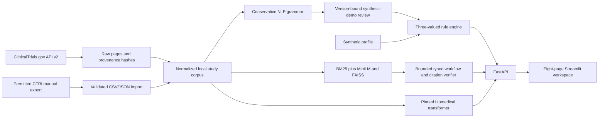
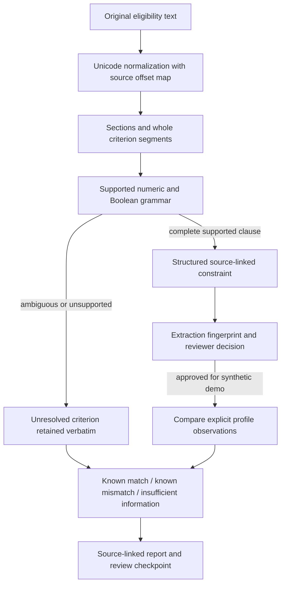

# TrialOps-Adaptive AI

**Cross-Region Clinical Trial Protocol Intelligence and Explainable Eligibility Pre-Screening Using Biomedical NLP, Retrieval, and Bounded Workflows**

M.Sc. Data Science · NLP Theory + Practical · Python 3.11 · FastAPI · Streamlit

TrialOps retrieves public trial registrations, detects biomedical entities, conservatively parses explicit requirements, compares source protocols, and evaluates fabricated profiles against reviewed known constraints. The local application and measured experiments run on CPU. Scientific and clinical validation remain separate from software verification.

This is an academic research demonstration for synthetic profiles, not medical advice, diagnosis, actual patient selection, or a complete clinical eligibility decision.

The current source snapshot has **58 real ClinicalTrials.gov studies**, including 32 with Indian sites, 30 with US sites, and four with both. Country groups records; all cutoffs come from the selected source protocol. Location does not determine ethnicity, nationality, risk, or medical suitability. The supplied fictional demo remains under `legacy/` and is excluded from the application corpus.

## Start the existing workspace

From this repository in PowerShell:

```powershell
.\scripts\start.ps1
```

Open [the application](http://127.0.0.1:8501) or [interactive API documentation](http://127.0.0.1:8000/docs). Check and stop the tracked services with:

```powershell
.\scripts\smoke.ps1 -Full
.\scripts\stop.ps1
```

Startup reuses healthy existing services. Shutdown checks process identity and stops only services it owns. Detailed commands and actual Docker evidence are in [deployment instructions](docs/deployment.md).

## Fresh checkout and Windows setup

Clone the source repository, then create an isolated Python 3.11 environment. The committed public registry snapshot is enough to open the application; downloading CHIA or retraining a model is not required for startup.

```powershell
git clone https://github.com/Bitu-Singh-Rathoud/NLP.git
cd NLP
py -3.11 -m venv .venv
.\.venv\Scripts\python.exe -m pip install --upgrade pip
.\.venv\Scripts\python.exe -m pip install --index-url https://download.pytorch.org/whl/cpu torch==2.14.1
.\.venv\Scripts\python.exe -m pip install -r requirements.txt
.\.venv\Scripts\python.exe -m pip check
.\scripts\start.ps1
```

The explicit PyTorch CPU-wheel install avoids CUDA runtime downloads. `requirements-lock-windows.txt` records the complete tested Windows environment. Use it instead of `requirements.txt` in the dependency step when reproducing that environment on Python 3.11 Windows, after installing the CPU wheel. The Docker backend uses the same CPU-wheel-first approach.

Model weights are downloaded from public pinned revisions on first use and cached under ignored `models/hf/`; a first request can take longer. No API key is needed for the three public pretrained models. The Git repository does not include their weights, the generated vector index, the trained head, or local review decisions. Run `python -m scripts.model_smoke`, `python -m scripts.build_index`, and `python -m scripts.generation_smoke` with the environment's Python to populate the models/index needed by those features. For offline use after downloading, set `$env:HF_HUB_OFFLINE='1'` before startup; a missing local cache must be populated first.

Without startup scripts, use two PowerShell windows:

```powershell
# Window 1, from the repository root
.\.venv\Scripts\python.exe -m uvicorn backend.app.main:app --host 127.0.0.1 --port 8000
```

```powershell
# Window 2, from the repository root
$env:API_BASE_URL='http://127.0.0.1:8000'
.\.venv\Scripts\python.exe -m streamlit run frontend/app.py --server.address 127.0.0.1 --server.port 8501
```

The scripts do not load `.env` automatically. Set environment variables in PowerShell. Compose reads `.env` if one is created from `.env.example`; credentials must never be committed.

## Problem and research objectives

Eligibility language combines measurements, negation, logical scope, temporal conditions, exceptions and investigator judgment. NER identifies spans but does not establish executable semantics. This project separates source retrieval, entity detection, supported grammar parsing, review, and deterministic comparison so uncertainty remains visible.

The research objectives are to measure extraction transfer on independent annotations, quantify the conservative parser's scope and failures, compare actual regional study subsets without causal claims, test synthetic-profile logic, and measure retrieval ablations and resource use. Learned regional adaptation requires independent comparable regional labels; this dataset does not supply them.

## Application pages

| Page | Executed operation |
|---|---|
| Overview | Corpus counts, overlapping site groups, parsed/unresolved counts, statuses and conditions |
| Explore Trials | Filter actual metadata and inspect original eligibility, locations and provenance |
| NLP Laboratory | Source or standalone text, baseline entities/rules, real biomedical NER, uncertainty and review |
| India & US Comparison | Two source protocols, registry ages, matching conditions, parsed constraints and unresolved text |
| Synthetic Evaluation | Explicitly fabricated profile, version-bound review, per-rule results and unresolved requirements |
| Research Assistant | Bounded tools, hybrid retrieval, exact source-offset verification, trace and optional generated draft |
| Evaluation Dashboard | Saved measured experiment data, model comparisons and runtime information |
| Download Reports | Real source-linked JSON, formula-protected CSV and printable HTML |

## Architecture





## Data, provenance and licenses

`data/raw/clinicaltrials/` preserves four original API response pages plus request parameters, UTC timestamps, URLs, SHA-256 sidecars and a run manifest. `data/processed/` contains `studies.csv`, `eligibility_criteria.csv`, `study_locations.csv`, `study_metadata.json`, and the application JSON corpus. The sample includes all statuses, not just currently recruiting records; it is a small convenience sample rather than representative regional sampling. A listed country does not establish that its individual sites are actively recruiting.

Re-fetch with `.\.venv\Scripts\python.exe -m scripts.ingest --per-region 30`. Live registry changes can produce a different selection. Pagination, retries, missing optional fields, structural changes, duplicate IDs, overlapping countries and failed-run preservation are tested.

CTRI's inspected public search requires a security code. No access control was bypassed and no native CTRI record is claimed. A compliant manual import is implemented: `.\.venv\Scripts\python.exe -m scripts.import_ctri path\to\actual_records.json`. [Data-source documentation](docs/data_sources.md) specifies the exact schema, license/access evidence and attribution.

The **CHIA v2 with_scope** corpus is CC BY 4.0, attributed to Kury et al. (2020). Download the exact experimental archive using `.\.venv\Scripts\python.exe -m scripts.download_chia`. It is ignored by Git. Original CRLF characters count toward BRAT offsets and must be preserved. Invalid annotations are explicitly excluded and reported, rather than silently repaired. MACCROBAT's license was investigated; the corpus was not imported as patient data.

## NLP and deterministic semantics

The baseline implements NFKC normalization, section/sentence and whole-clause segmentation, tokenization with original offsets, abbreviation recognition, entity patterns, units, numeric comparison and negation. Medically meaningful words such as `no`, `not`, `without`, `and` and `or` remain. Lemmatization/stemming are intentionally not used to rewrite clinical rule text; TF-IDF uses normalized tokens while preserving negation and connectives.

Only a fully recognized criterion becomes executable. Supported operators include `gt`, `gte`, `lt`, `lte`, `equals` and explicit inclusive/exclusive ranges. Supported measurements are age, BMI, HbA1c and systolic/diastolic blood pressure. Explicit Boolean conditions and nested supported AND/OR/NOT use three-valued logic. Temporal conditions, ambiguous qualifiers, mixed unclear scope, unsupported units and partially recognized clauses remain unresolved. Units are canonicalized only by documented conversions. [Rule semantics](docs/rule_semantics.md) explains bounds, missingness, exclusions, scope and conversion sources.

`validated=True` means recognized grammar or explicit registry metadata, not clinical approval. The application requires an additional version-bound local review before a supported study rule can evaluate a synthetic profile. The SQLite review record binds study ID, extraction hash, rule IDs, decision, reviewer label and time. These unauthenticated labels are a local demonstration audit trail, not proof of expert identity. Changed source/rule semantics invalidate prior approvals. Conflicting un-rejected source constraints block a profile conclusion.

A missing observation is UNKNOWN. Absence from a list of positive diagnoses is not evidence that a condition is absent. A definite false conjunct can establish a known mismatch while unrelated unresolved conditions remain listed. Conflicts require review. The three statuses are:

- `MATCHES_KNOWN_CRITERIA`: supported supplied constraints match; this does not establish full trial eligibility.
- `DOES_NOT_MATCH_KNOWN_CRITERIA`: a reviewed known condition is false.
- `INSUFFICIENT_INFORMATION`: required observations/reviews/semantics are missing or constraints conflict.

## Models and generation

| Component | Actual model | Status |
|---|---|---|
| Biomedical spans | `d4data/biomedical-ner-all` | Executed CPU inference; original source offsets and overlapping token windows |
| Semantic retrieval | `sentence-transformers/all-MiniLM-L6-v2` | Executed 384-dimensional embeddings, FAISS and BM25 fusion |
| Adapted extractor | Frozen biomedical encoder plus 5,383-parameter CHIA BIO head | Trained/evaluated experiment; isolated from eligibility execution |
| Optional draft | `google/flan-t5-small` | Executed local CPU generation; incomplete output observed; experimental and unverified |
| Optional external local server | Configured Ollama model | Adapter and outage behavior tested; no Ollama inference claimed |

The project does not fine-tune FLAN-T5 or the complete biomedical transformer. Its completed training experiment optimizes only the small CHIA classification head with the encoder frozen. That experimental head is not the default application's parser or eligibility engine.

All three public pretrained repositories declare Apache-2.0. Revisions, cache behavior, licenses, context windows and measured inference are in [model documentation](docs/models.md), [adaptation results](docs/adaptation.md), and `reports/generation_smoke.json`. Loading forbids remote code and uses safetensors. The adapted head is saved under ignored `models/adapted_chia_head/` with a checksum manifest.

Generation runs only when explicitly requested in the assistant. `GENERATOR_BACKEND=local` is the default; `none` disables it, and `ollama` uses `OLLAMA_URL` plus `OLLAMA_MODEL`. A generated draft is never a rule, eligibility decision, or verified source assertion. The tested small model returned only “Glycated hemoglobin” for a real question asking for an HbA1c requirement; this demonstrates an answer-quality limitation despite successful inference. Exact source excerpts remain the primary useful answer. Context selection/truncation and a narrow numeric-token guard are reported; that guard does not verify entailment.

## Retrieval and bounded workflow

The current corpus produces 426 exact source chunks. BM25 ranks token overlap; MiniLM vectors use normalized inner-product FAISS search. Hybrid retrieval uses reciprocal-rank fusion `sum(1/(60+rank))`. Chunks retain study ID, source field, start/end offsets and source URL. Persisted embeddings have corpus/model fingerprints and checksums; runtime rebuilds FAISS from validated NumPy arrays with pickle disabled. Explicit `actual_mode` distinguishes semantic results from BM25 fallback.

The workflow is a small typed finite-state equivalent to a graph orchestrator: interpret query, invoke permitted retrieval/extraction/comparison/evaluation tools, verify exact source spans, and compile a report with a review checkpoint. It has a six-step execution limit. Documents cannot choose tools or run code. Unsupported question intents and missing evidence abstain; ambiguous negative recruitment wording asks for an explicit status rather than silently reversing intent. This is bounded orchestration, not an autonomous LLM agent or clinical reasoning system.

## Measured experiments

| Experiment | Observed result | Interpretation |
|---|---|---|
| CHIA entity transfer, 40 docs/20 held-out studies/328 gold spans | Dictionary F1 **0.4253**; pretrained biomedical NER **0.1265** | Exact mapped category and source span; ontology/domain mismatch limits comparison |
| Frozen-encoder CHIA head, 100 train/20 dev studies | Test F1 **0.3212**, epoch 8 chosen on dev | Real supervised head adaptation; baseline dictionary used more training data |
| Developer parser test references | Full match **10/12** supported; abstained on **8/8** unsupported | Developer engineering references, not blinded expert labels |
| Real registry parser coverage | **18/983 (1.83%)** segments fully supported; all 58 studies need review | Coverage, not extraction accuracy |
| Synthetic rule robustness | **18/18** authored expected statuses | Software behavior, not patient outcome prediction |
| Retrieval ablation, 12 heuristic mention queries | P@5 BM25 **0.6000**, semantic **0.7167**, hybrid **0.8333** | Explicit keyword-mention relevance labels, not independent human judgments |
| Regional descriptive vocabulary shift | India-only/US-only JSD **0.2026** overall; **0.3955** in the small test subset | Descriptive shift; no causal or learned regional adaptation claim |

The trained head improved over the untouched transformer but remained below the dictionary. More complex models did not automatically produce better extraction. The parser deliberately misses unsupported synonyms and most real complex criteria rather than executing incomplete interpretations. Full metrics, confusion counts, failure examples, splits, latency, memory and charts are in `reports/` and the [technical report](docs/technical_report.md).

Reproduce experiments:

```powershell
.\.venv\Scripts\python.exe -m scripts.download_chia
.\.venv\Scripts\python.exe -m scripts.model_smoke
.\.venv\Scripts\python.exe -m scripts.build_index
.\.venv\Scripts\python.exe -m experiments.entity_benchmark --test-studies 20
.\.venv\Scripts\python.exe experiments/adapt_entity_head.py --train-studies 100 --dev-studies 20 --epochs 8
.\.venv\Scripts\python.exe -m experiments.research_eval
.\.venv\Scripts\python.exe -m experiments.retrieval_benchmark
.\.venv\Scripts\python.exe -m scripts.generation_smoke
```

Numbers and timings can change with hardware/library versions. Fixed splits, model revisions and raw snapshots support reproduction; no clinical accuracy or statistical significance is inferred. No confidence intervals are attached to deliberately chosen reference examples or twelve concept queries. Span FPR is undefined without a specified true-negative universe; FP counts and precision are reported instead. [Annotation workflow](docs/annotation_workflow.md) separates published CHIA labels, developer references, synthetic profiles, unlabeled real-registry documents and model predictions.

## Mathematical notes

TF-IDF represents term frequency weighted by inverse document frequency. This experiment uses scikit-learn's smoothed `idf(t)=log((1+N)/(1+df(t)))+1` with L2 document normalization, fitted on training studies only. Cosine similarity is `dot(x,y)/(norm(x)*norm(y))`; normalized embeddings reduce it to inner product.

Entity precision is `TP/(TP+FP)`, recall `TP/(TP+FN)`, and `F1=2PR/(P+R)`, with exact span/category equality. Binary parser FPR is `FP/(FP+TN)` for explicitly labeled executable-versus-unsupported reference cases, not for arbitrary medical statements. JSD is `0.5*KL(P||M)+0.5*KL(Q||M)`, where `M=(P+Q)/2`, using base-2 logs. The adapted head minimizes class-weighted token cross-entropy on unambiguous training labels while keeping the transformer frozen; development F1 selects the epoch. No regional adaptation objective was optimized.

Deterministic rules are used for explicit comparisons because they make bounds, missing values and contradictions reproducible. Generative predictions are not allowed to modify protocol cutoffs or resolve unknown patient observations.

## API reference

| Method | Path | Contract |
|---|---|---|
| GET | `/health`, `/dashboard` | Readiness and actual corpus/processing counts |
| GET | `/studies` | Optional country, condition, overall status and identifier filters |
| GET | `/studies/{study_id}` | Original record and versioned extraction/reviews |
| POST | `/extract` | `{text, study_id?, transformer}`; supplied study text must equal its source |
| POST | `/compare` | `{study_ids: [left, right]}` |
| POST | `/reviews` | Exact study/extraction hash/rule IDs, decision, reviewer and synthetic-demo purpose |
| POST | `/evaluate` | Specific study plus strict `is_synthetic: true` profile |
| POST | `/ask` | Question, mode, country/status filters, evidence count and optional draft/profile |
| GET | `/metrics` | Actual saved experiment artifacts only |
| GET | `/reports/{study_id}` | `format=json`, `csv` or `html` |

Pydantic rejects unknown profile fields and invalid/nonfinite measurements. The API bounds request bytes and text sizes, uses configured CORS origins and network timeouts, and returns missing IDs/errors explicitly. Input validation does not echo submitted profiles. It is a local research application without production authentication or authorized clinical access controls; do not expose it publicly for real patient workflows.

## Tests and verification

```powershell
.\.venv\Scripts\python.exe -m pytest -q
.\.venv\Scripts\python.exe -m scripts.integration_smoke
.\.venv\Scripts\python.exe -m scripts.ui_smoke
.\.venv\Scripts\python.exe legacy/TrialOps_Adaptive_Demo/trialops_adaptive_demo.py --test
```

Unit and integration tests cover source integrity, pagination/outages, schema changes, parser safety, bounds, exclusions, negation, AND/OR/NOT, missing units, contradictions, review versions/revocation, filters, unknown statuses, oversized/nonfinite data, source injection, model unavailability and UI regressions. Live HTTP and Streamlit smoke scripts use real models/corpus operations. The default pytest discovery is `tests/`; frozen legacy components belong under `legacy/` and are verified separately without deletion. Current test counts and commands are generated into `reports/test_results.json` by `python -m scripts.verify`.

The saved full verification on 18 October 2026 records **150 passed, zero failed and zero skipped**, a passing dependency check, separate legacy sanity checks, and successful live integration/UI smoke runs. These are software checks, separate from the NLP quality measurements above. To refresh machine-readable verification, run `.\.venv\Scripts\python.exe -m scripts.verify`; add `--live` after starting the backend and frontend to include the live checks.

## Docker

```powershell
docker compose up --build
```

Compose configuration validation passed. An actual build was attempted but the installed Docker Desktop engine failed before an image could build: its Linux-engine named pipe is missing and its backend log reports an inaccessible `dockerInference` socket rename. Container startup is therefore **unverified**. [Deployment evidence](reports/deployment.json) records the exact error and successful independent local startup/reuse/shutdown checks. Resolve that local Docker runtime problem, then rerun the documented build and smoke commands; no public deployment is claimed.

## Repository map

`backend/app/`: APIs, ingestion/store, NLP, models, retrieval, reviews, rule evaluation and workflow. `frontend/app.py`: all eight UI pages. `experiments/`: actual reproducible evaluations/training. `data/annotations/`: schema, developer references and unlabeled registry queue. `data/synthetic/`: seeded fabricated profiles. `scripts/`: ingestion, model/index runs, local operations, verification and report generation. `tests/`: active suite. `reports/`: measured outputs and graphs. `docs/`: methods, technical report, demonstration outline, viva answers and completion matrix. `legacy/`: untouched supplied demo.

The [complete Hinglish explanation and viva script](docs/project_explanation_hinglish.md) walks through the project, NLP/model roles, actual training, India/US rationale, architecture, Docker status and demonstration. Its [formatted HTML version](docs/project_explanation_hinglish.html) can be downloaded and opened locally for navigation and printing; GitHub displays HTML source rather than hosting the application.

## Source contents and reproducibility boundaries

The repository contains ordinary source files, tests, Dockerfiles, Compose configuration, dependency pins, experiment scripts, documentation, the small public registry snapshot with provenance, synthetic fixtures, and measured report artifacts. The supplied prototype is preserved under `legacy/`; it is not silently substituted for the working application. The source is not distributed as a giant ZIP in place of these folders.

`.gitignore` excludes virtual environments and Python caches, `.env` and local Streamlit secrets, model weights and downloaded model caches, external corpora (including the separately downloaded CHIA archive), generated vector indexes, SQLite review databases, local process state/logs, and ZIP archives. Keep real patient records, credentials and private/restricted exports out of version control. `.env.example` documents configuration without supplying credentials.

To reproduce CHIA results, obtain the separately attributed licensed dataset with `scripts.download_chia`, cache the pinned biomedical model with `scripts.model_smoke`, run the entity benchmark first, then run the head-adaptation experiment using the commands above. The head experiment deliberately loads the encoder from the local cache and verifies the original held-out benchmark artifacts. Public registry refreshes, model downloads and first-time corpus acquisition require network access; the saved source snapshot and report metrics do not imply these external artifacts are bundled.

## Limits, ethics and further research

No real patient records, disease-risk predictions or medical recommendations are used. Expert verification of the newly retrieved real criteria is unavailable. Public registry content is sponsor submitted and may be incomplete or outdated. The sample is small, convenience selected and not representative; subgroup coverage is not subgroup accuracy. Native CTRI automated ingestion remains constrained by observed access restrictions, with compliant manual import supplied.

The parser's low real-world coverage is a substantive limitation. The reference tests are developer authored and not blinded; CHIA ontology mapping and its single test subset limit generalization. The head adaptation uses one seed and unequal training volume versus the dictionary. The local generator has limited answer quality and does not verify entailment. Review labels are not authenticated expert identities. Clinical validation, larger independent annotation, protocol-family split design, more robust semantic parsing, calibrated abstention, multiple-seed training and properly labeled regional transfer experiments are future research, not completed claims.

The entity-model comparison is not a controlled three-way structured-rule extraction benchmark. No large independently human-verified rule-level gold set, schema-constrained LLM rule-extraction comparison, or proven country/phase domain adaptation is claimed. Entity F1 must not be presented as patient-matching or complete-rule accuracy.

See [feature completion and blockers](docs/feature_completion.md), [technical report](docs/technical_report.md), and [professor demonstration/viva notes](docs/demo_and_viva.md).

## Data/model credits and authorship

- Public trial records: [ClinicalTrials.gov](https://clinicaltrials.gov/) and its [official API v2 documentation](https://clinicaltrials.gov/data-api/api).
- Published entity annotations: Kury et al. (2020), [Chia Annotated Datasets v2](https://doi.org/10.6084/m9.figshare.11855817.v2), CC BY 4.0; original corpus downloaded separately.
- Biomedical entity model: [d4data/biomedical-ner-all](https://huggingface.co/d4data/biomedical-ner-all).
- Semantic embeddings: [sentence-transformers/all-MiniLM-L6-v2](https://huggingface.co/sentence-transformers/all-MiniLM-L6-v2).
- Optional generated drafts: [google/flan-t5-small](https://huggingface.co/google/flan-t5-small).

Development involved AI assistance. The source code, recorded commands and experiment outputs, data lineage, and independent reruns are the evidence for technical claims. Documentation and passing software tests do not establish clinical validity. Existing third-party data/model licenses and attribution requirements remain applicable; see [data sources](docs/data_sources.md) and [model details](docs/models.md).
