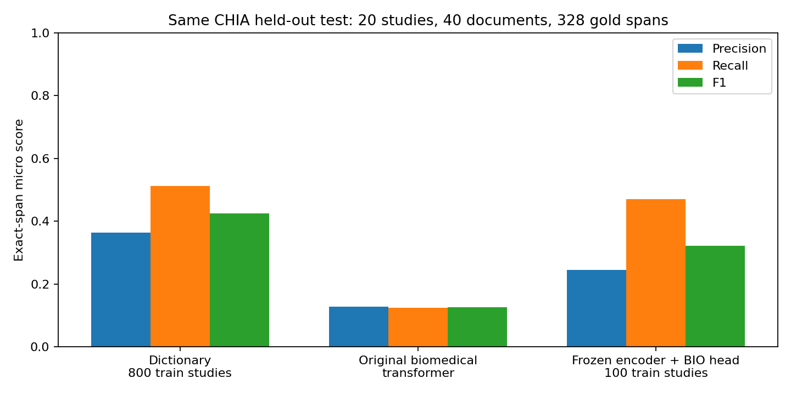
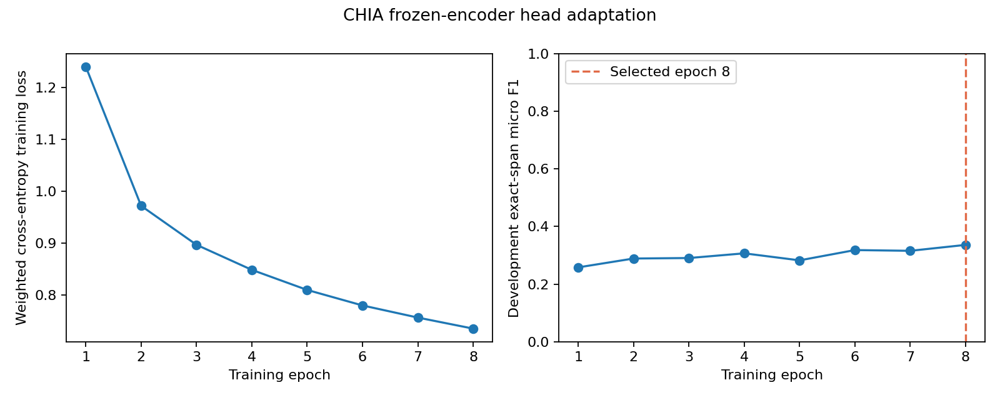
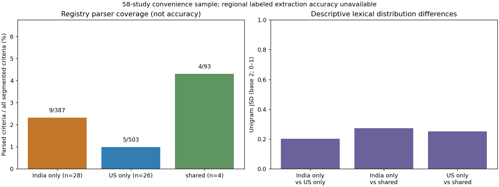
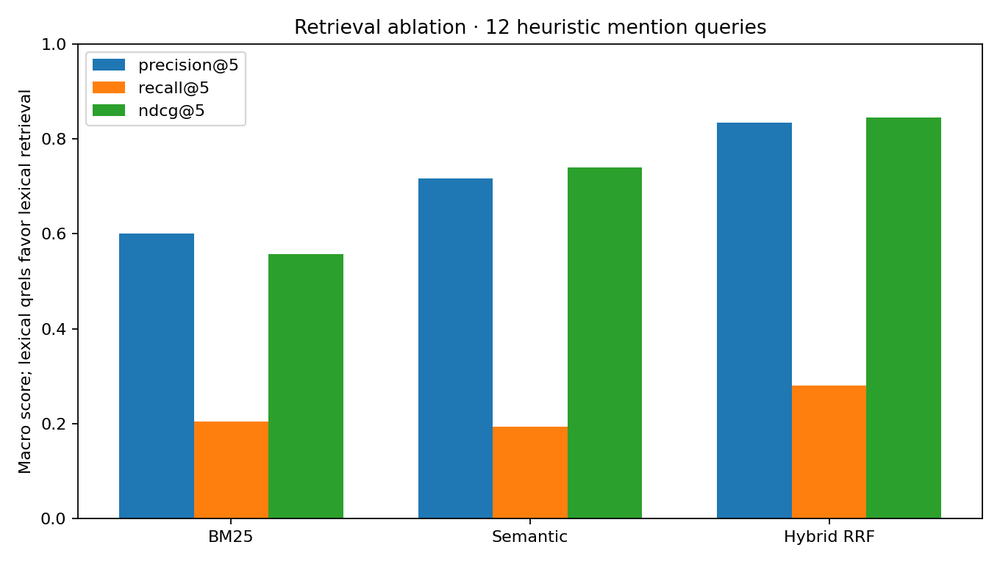

# TrialOps-Adaptive AI: Academic Technical Report

Cross-Region Clinical Trial Protocol Intelligence and Explainable Eligibility Pre-Screening

**Academic context:** M.Sc. Data Science, NLP Theory + Practical. **Implementation:** Python 3.11, FastAPI, Streamlit, local persistent files and review SQLite. **Verification date:** see the UTC timestamps in the linked experiment artifacts.

## Abstract

This project implements a reproducible clinical-trial protocol reader using 58 real ClinicalTrials.gov registrations focused on type 2 diabetes, biomedical NER, a conservative rule grammar, source-grounded retrieval and a bounded tool workflow. The prototype evaluates synthetic profiles only. Published CHIA annotations support an exploratory independent entity benchmark; developer-authored references support engineering tests. A supervised frozen-encoder head adaptation was actually trained and evaluated. The system exposes eight working Streamlit pages and a tested FastAPI service.

The main negative findings are low complete-clause parsing coverage on real complex criteria, poor cross-corpus performance of the untouched biomedical model, and incomplete generation from the small local language model. Software behavior is verified locally; these findings do not establish clinical validity, representative regional generalization or eligibility for actual patients.

## 1. Problem, objectives and scope

Unstructured eligibility clauses contain inclusion/exclusion scope, measurements, units, negation, temporal conditions and exceptions. Detecting an entity such as HbA1c does not determine its operator, threshold or logical role. The objectives are source-traceable extraction, deterministic synthetic comparison, bounded retrieval/workflow operations, explicit uncertainty, measured baselines/adaptation, and reproducible deployment.

India and US labels refer to listed study sites. They never introduce population-specific thresholds or substitute for protocol requirements. A study can appear in both descriptive country counts; mutually exclusive groups are used when comparing regional text distributions. There is no real-patient cohort, diagnosis, risk prediction or authorized clinical selection.

## 2. Audit and data collection

The supplied legacy program was read and reproduced: 30 fictional profiles, two fictional protocols, 60 comparisons and four passing original checks. It supplies useful deterministic/missing-value semantics, but no trained model or real protocols. It remains unchanged under `legacy/` and outside active pytest discovery.

The real API v2 collection requested 30 relevance-ranked records from each of India and the US, retained actual listed-location matches, and deduplicated NCT IDs. The result is 58 distinct studies, 32 listing Indian sites, 30 listing US sites, and four listing both. Four response pages and 1,226 location rows were saved. The sample includes seven records with overall status RECRUITING and 39 COMPLETED; presence of a site does not prove that site is currently recruiting. It is a convenience sample across statuses.

Raw response bytes, request URL/parameters, UTC retrieval time, SHA-256 and selected IDs are preserved. Normalized JSON plus studies, criteria and location CSV tables retain source links and last-update fields. Tests verify original criterion text and raw hashes for every shipped study. Pagination, retries/outages, malformed schema and missing optional fields have explicit behavior; a failed run does not silently replace the last good corpus.

CTRI public access inspected during implementation required a security code. No access control was bypassed and zero native CTRI records are claimed. The implemented CSV/JSON manual-import workflow validates real IDs, source hosts, retrieval timestamps and provenance. It supports an authorized human export when available.

CHIA v2 with_scope is a public CC BY 4.0 annotated corpus covering 1,000 studies and 2,000 inclusion/exclusion documents. The exact archive is fingerprinted in the data documentation and reproducible downloader. Original CRLF characters are preserved. Defective annotation/source alignments are excluded and logged rather than guessed. Published annotation labels, developer references, synthetic profiles, unannotated regional documents and predictions remain distinct.

## 3. NLP implementation

The classical pipeline performs NFKC normalization with a map to original offsets, section and sentence/whole-criterion segmentation, tokenization, biomedical abbreviation patterns, entity/numeric/unit recognition and negation/scope parsing. Stopwords are not removed from clinical grammar; meaningful negations and connectives remain. TF-IDF uses normalized unigrams with no stemming or lemmatization so the feature-processing choices do not silently rewrite clinical meaning.

The deterministic grammar supports explicit age, BMI, HbA1c and blood-pressure comparisons, inclusive/exclusive bounds, selected explicit Boolean conditions, AND/OR/NOT, canonical units and documented conversions. A whole criterion is the safety unit: a recognized numeric fragment cannot make a partially understood clause executable. Unsupported temporal wording, qualifiers, ambiguous shared scope, malformed measurements and unsupported terminology remain NEEDS_REVIEW.

The real pretrained model is `d4data/biomedical-ner-all` at a pinned revision, loaded with safetensors and remote code disabled. It processes all tokens using overlapping 512-token windows rather than silently truncating protocols. Output consists of exact original entity spans, labels and model scores. NER never authorizes a clinical rule. The model's clinical-case-report training domain and ontology differ from trial eligibility annotation.

## 4. Rule review and synthetic evaluation

Structured source age/sex fields supplement text parsing. Their constraints are included in extraction fingerprints and conflict checks. A supported-grammar flag denotes syntactic/semantic recognition within the declared grammar; it is not expert approval. The application executes study rules only after a separate local synthetic-demo review bound to the exact extraction hash and rule IDs.

Reviews persist in SQLite with decision, reviewer label, scope and time. These local labels are unauthenticated and do not establish clinician identity. Changed source semantics invalidate old approval versions. Changing a review clears any saved UI evaluation so a revoked approval cannot leave a stale matching result visible. Source conflicts remain blocking until conflicting interpretations are resolved/rejected.

Evaluation uses TRUE/FALSE/UNKNOWN. Missing observations are unknown, and a positive diagnosis list does not establish negative findings. AND/OR/NOT preserve uncertainty. The statuses are MATCHES_KNOWN_CRITERIA, DOES_NOT_MATCH_KNOWN_CRITERIA, and INSUFFICIENT_INFORMATION. Even a known-criteria match does not prove complete protocol eligibility; source and unresolved requirements remain visible.

## 5. Independent entity benchmark and actual adaptation

The entity experiment maps CHIA Condition/Drug/Procedure to a documented subset of the pretrained model's labels. Exact category and character-span agreement is required; discontinuous gold spans remain in evaluation. Twenty held-out study IDs supply 40 documents and 328 gold entities. A dictionary learns only from 800 separate training studies. This is a fixed exploratory test subset, not an official benchmark split; shared upstream training exposure cannot be ruled out.

| Model | Precision | Recall | F1 | TP | FP | FN |
|---|---|---|---|---|---|---|
| training_dictionary | 0.3636 | 0.5122 | 0.4253 | 168 | 294 | 160 |
| biomedical_transformer | 0.1281 | 0.1250 | 0.1265 | 41 | 279 | 287 |
| adapted_frozen_encoder_head | 0.2441 | 0.4695 | 0.3212 | 154 | 477 | 174 |

The adapted model freezes the entire biomedical encoder and trains only a new 5,383-parameter seven-label BIO head. It uses 100 training studies and 20 separate development studies, with the same original 20 test studies held out until epoch selection. Class-weighted token cross-entropy trains the head; epoch 8 is selected by development exact-span F1. Training loss decreased from 1.239686 to 0.735666. Ignored ambiguous supervision is documented; full mapped gold still counts in test scoring.

The head run took 39.21 seconds including loading, frozen encoding, training and evaluation; sampled peak process RSS was 953.13 MiB. These are CPU observations on this machine. This is supervised head adaptation, not end-to-end fine-tuning or learned India/US adaptation. The dictionary used more labeled training studies, so architecture is not isolated under equal training volume. The head improves over the untouched transformer but remains below the dictionary. No statistical significance or general superiority is inferred.

## 6. Parser, rule and regional experiments

There are 75 static developer-authored semantic reference cases: 45 expected executable and 30 unsupported. Labels were independently specified as field/operator/value/unit/type/negation/logical signatures, not generated from predictions. They are neither blinded nor expert clinical annotations. Source families remain together in train/dev/test bookkeeping splits, with no parser training or modification against these outcomes.

The developer TEST split has 20 cases: 12 supported and eight unsupported. Full supported-case signature match is 10/12 (83.3%). Confusion counts are TP=10, FP=0, TN=8, FN=2; FPR=0/8 and FNR=2/12. Test abstention is 10/20. Pooled full supported-case fidelity is 43/45, which must not be substituted for the held-out result. The two missed lexical formulations remain documented and unchanged. Zero false positives in eight selected test cases is not a clinical safety guarantee.

Eighteen additional authored synthetic profile scenarios produce 18/18 expected statuses, covering boundaries, missingness, negation, exclusions, AND/OR, units and contradictions. These are software-behavior labels, not patient outcomes.

| Disjoint site group | Studies | Criterion segments | Fully parsed | Coverage |
|---|---|---|---|---|
| India_only | 28 | 387 | 9 | 2.33% |
| US_only | 26 | 503 | 5 | 0.99% |
| shared | 4 | 93 | 4 | 4.30% |

Overall real-corpus complete criterion coverage is 18/983 (1.83%); all 58 studies retain unresolved requirements. This deliberately strict figure is coverage, not accuracy. Registry metadata rules are additional structured constraints and are not counted as successful text parsing. Human regional accuracy is unavailable because the newly retrieved studies have no independent expert labels.

The regional study split is deterministic by study ID, with 49 training and nine test studies. Shared India/US studies appear once in a separate group. The 2,190-term TF-IDF vocabulary is fit only on training text. Overall India-only/US-only unigram JSD is 0.202595; the tiny test subset (three India-only, six US-only studies) gives 0.395537. These descriptive values do not show clinical population differences, causal effects or learned adaptation. Exact duplicate text is audited, but related sponsor/protocol families are not fully clustered.

## 7. Retrieval, workflow and generation

Sentence Transformers `all-MiniLM-L6-v2` supplies 384-dimensional embeddings. FAISS uses normalized inner product, BM25 supplies lexical retrieval, and reciprocal-rank fusion combines ranks. The current index contains 426 exact source chunks with IDs, URLs, fields and offsets. Context windowing preserves coverage; model/corpus fingerprints and checksums protect stale/corrupt local artifacts. Runtime avoids untrusted pickle or native FAISS deserialization. Model failure is explicitly reported as fallback, not advertised as semantic success.

| Mode | P@5 | Recall@5 | nDCG@5 | Mean ms |
|---|---|---|---|---|
| bm25 | 0.6000 | 0.2036 | 0.5565 | 2.73 |
| semantic | 0.7167 | 0.1930 | 0.7396 | 25.81 |
| hybrid | 0.8333 | 0.2799 | 0.8442 | 20.98 |

These scores average twelve predeclared developer-selected concept queries with exhaustive heuristic term-mention qrels. They are not independent human semantic-relevance judgments. Mentions can be negated or merely contextual; relevance labels do not establish executable requirements. Confidence intervals are omitted because the concepts are deliberately chosen and nonrepresentative.

The bounded workflow is a typed finite-state equivalent to a graph orchestrator: interpret query; retrieve/extract/compare/evaluate through permitted functions; verify exact evidence offsets; compile a source-linked report and review checkpoint. It has a six-step limit, explicit abstention and no execution of document instructions. Filtering occurs before a typed study evaluation. Exact-ID retrieval reports its actual fallback mode. It is not an autonomous clinical reasoning agent.

Local `google/flan-t5-small`, a pinned Apache-2.0 77M-parameter model, actually generated a draft on CPU. The measured real-source output was **Glycated hemoglobin** for a question asking for the explicit HbA1c requirement. This is incomplete and is retained as a negative finding. Inference execution is successful; answer correctness is not established. The draft is optional, unverified, limited to selected source context, and never used by the rule engine. Numeric-token checks do not prove entailment. Primary responses retain verified source excerpts. An optional Ollama adapter handles configured servers and tested outages; no actual Ollama inference is claimed.

## 8. Engineering and verification

The FastAPI application provides strict Pydantic requests, byte/text limits, CORS allowlists, network timeouts, safe source/report handling and explicit failures. Invalid requests do not echo profile payloads. The Streamlit frontend provides all eight requested workspaces. Local files, persisted index artifacts and SQLite keep the architecture small. All demonstration profiles are fabricated.

| Verification command group | Exit code | Observed status |
|---|---|---|
| pytest | 0 | passed |
| dependencies | 0 | passed |
| legacy_separate | 0 | passed |
| compile | 0 | passed |
| integration_smoke | 0 | passed |
| ui_smoke | 0 | passed |

The saved active pytest run reports 150 passed, 0 failures, 0 errors, and 0 skipped. Source code is fingerprinted and unchanged during that verification run: `54d25a21ccf23f54dd223fe367bee9905c6b5fbaa3740d19c4b4081070d7c0c1`. Legacy checks run separately and remain visible. Live HTTP integration status is passed; the UI harness reports 17 successful page/action checks against the live backend. Tests also exercise isolated UI review approval/revocation and unknown-status records.

Measured regression fixes include stale evaluation invalidation on review changes, rejecting huge/nonfinite measurements cleanly, preserving unknown status semantics, merged metadata/text contradiction checks, exact-ID filter enforcement, consistent retrieval provenance, and preventing 'show us' or 'not currently recruiting' from silently becoming positive US/recruiting filters. Source-injection tests prove the workflow cannot convert retrieved text into tool instructions; they do not constitute a general language-model safety certification.

## 9. Deployment and blockers

Local FastAPI and Streamlit health checks pass at http://127.0.0.1:8000 and http://127.0.0.1:8501. PowerShell startup, existing-service reuse, owned-process shutdown and isolated-port startup/shutdown were exercised. JSON/CSV/HTML reports preserve evidence and unknowns. There is no public deployment or production clinical authorization.

Dockerfiles, Compose networking, local-only published ports, non-root users, health checks and persistent data/model mounts are implemented. Compose configuration validates. The actual build attempted on this machine failed before an image build because the installed Docker Desktop Linux engine pipe is missing. Starting Desktop revealed an inaccessible `dockerInference` socket rename in its backend log. No container build/start success is claimed. The exact evidence is in `reports/deployment.json`; resolving that local Docker runtime problem and rerunning the commands remains an external deployment blocker.

## 10. Threats to validity and ethics

The real registry sample is small, nonrandom, multilingual metadata can vary, and source records can change. Sponsor-submitted records are not independently clinically verified. The parser's narrow grammar has very low real-protocol coverage. Developer references are selected and nonblinded; ontology mapping, span defects and one held-out CHIA subset limit entity conclusions. Model pretraining leakage cannot be fully audited. Head training uses one seed and a smaller training set than the dictionary. Retrieval qrels are lexical heuristics. CPU/RSS measurements are local process observations, not deployment guarantees or exclusive per-model memory. Softmax and cosine scores are not calibrated clinical probabilities.

No actual patients are processed or selected. Country never changes source thresholds. Missing observations and unsupported semantics remain unknown. Local review labels do not replace expert validation. The generated model is limited and can produce incomplete or unsupported prose; citations verify quoted bytes, not entailment of generated statements. A real application would require independent clinician review, privacy/access governance, clinical validation and appropriate authorization.

## 11. Reproduction, further research and references

Use the README and `docs/deployment.md` for exact Windows/Compose commands. Download the fingerprinted CHIA archive, run the three entity/research/retrieval experiments and model/generation smoke scripts, start services, then run `python -m scripts.verify --live`. Regenerate this report with `python -m scripts.build_documentation`. Raw predictions, splits, exclusions, CSV results, checksums and plots are retained for independent review. Model weights and downloaded external corpora are excluded from Git and the release archive.

Independent expert regional annotation, protocol-family-aware sampling, multi-reviewer agreement, multiple random seeds, equal-data architecture comparisons, stronger temporal/scope parsing, calibrated abstention and a higher-quality entailment-checked generation backend are future work. Learned regional adaptation remains unperformed because comparable regional gold is unavailable.

- ClinicalTrials.gov. [API v2 documentation](https://clinicaltrials.gov/data-api/api) and [terms](https://clinicaltrials.gov/about-site/terms-conditions).
- Kury et al. (2020). [Chia, a large annotated corpus of clinical trial eligibility criteria](https://doi.org/10.1038/s41597-020-00620-0). [Annotated dataset v2](https://doi.org/10.6084/m9.figshare.11855817.v2), [CC BY 4.0](https://creativecommons.org/licenses/by/4.0/).
- [MACCROBAT dataset](https://figshare.com/articles/dataset/MACCROBAT2018/9764942), inspected for access/license; not imported as a patient cohort.
- [Biomedical NER model card](https://huggingface.co/d4data/biomedical-ner-all), [MiniLM model card](https://huggingface.co/sentence-transformers/all-MiniLM-L6-v2), [FLAN-T5-small model card](https://huggingface.co/google/flan-t5-small).
- CTRI. [Official registry search](https://ctri.nic.in/Clinicaltrials/advancesearchmain.php); compliant manual import only.

Source methods, attribution and exact revisions are expanded in `docs/data_sources.md`, `docs/models.md`, `docs/adaptation.md`, `docs/annotation_workflow.md` and the raw JSON experiment reports. No publication-level or clinical validation is implied by the software deliverable.
